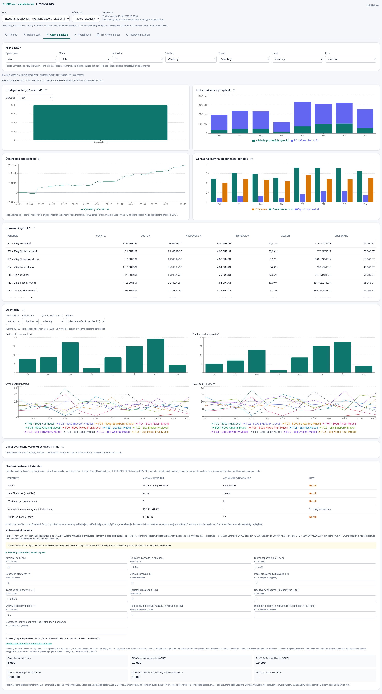
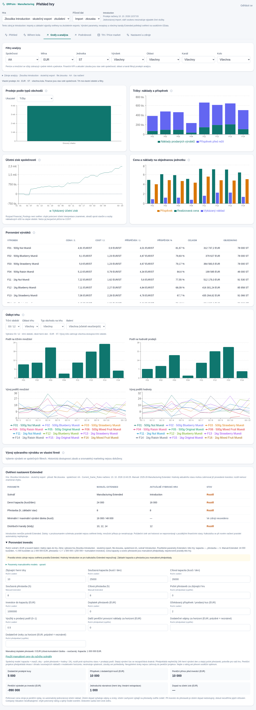
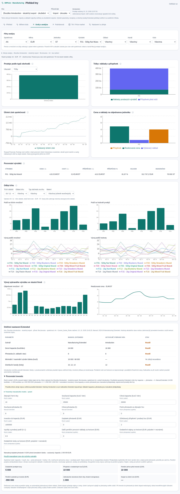

# Grafy a analýza – ověření a omezení

Větev `feat/charts-analysis` vychází z `ddc0f77` (feat/web-supabase po PR #6). Nová záložka zachovává Přehled, Během kola, Podrobnosti, trh i kompletní sklad. Mění pouze web: **bez SQL migrace, aktualizace Python synchronizátoru, změny service/.env nebo produkčních dat**.

## Dostupná data

Používá stejné uložené úplné snímky a společné filtry jako ostatní pohledy. Nevytváří historii ze současného stavu. Obnovení dashboardu 15 s zůstává zachováno; v historickém režimu používá vybrané snímky. Hra je oddělena již datovým API, další rozměry jsou původ a společnost. Měny a jednotky se neagregují dohromady.

- `Sales`: `QUANTITY` = objednáno, `QUANTITY_DELIVERED` = dodáno; `NET_VALUE`, `COST`, `CURRENCY`, `UNIT`, výrobek, oblast, kanál a herní čas. Názvy kanálů z vybraných pravidel / zdroje cen; neznámý kanál zůstává kódem. Alternativní prodejní export se nepřičítá k Sales.
- Rozpad tržeb = vykázaný COST + (NET_VALUE − COST). Záporné části používají oddělené znaménkové skládání. Příspěvek není čistý zisk. COST je náklad vykázaný na prodejním řádku, **není doloženou aktuální výrobní nebo mezní kalkulací**. Jednotkové údaje dělí oba součty stejným objednaným množstvím; výslovně nejsou nákladem na dodanou část nebo na dnešní výrobu. Záporné hodnoty zůstávají; nulový jmenovatel a neúplné skupiny dávají nedostupný poměr.
- `Company_Valuation.PROFIT` je samostatná řada vykázaného účetního stavu společnosti přes všechna dostupná herní období. Nefiltruje se oblastí, kanálem ani výrobkem, nesčítá se přes čas a nepřičítá se k příspěvku.
- `Financial_Postings` ve zkušebním sešitu obsahuje `GL_ACCOUNT_NUMBER/NAME`, `FS_LEVEL_1..4`, `DEBIT_CREDIT_INDICATOR`, `AMOUNT` a herní čas. Samotná existence těchto polí nepotvrzuje, že jejich součtem dostaneme tok nákladů za vybrané období. Dokud neověříme saldo/obrat, znaménka a účtování proti SAP výkazu, graf rozpadů nákladových účtů není aktivní. Náklady již obsažené v COST se nesmí započítat podruhé.
- `Market`: úplný trh nezávislý na existenci vlastních prodejů. Podíl = součet množství/hodnoty výrobku / součet odpovídajícího trhu, vždy stejná měna, jednotka a `SIM_ROUND / SIM_PERIOD`. Tržní období není herní den. Vlastní výběr období, oblasti, kanálu a balení neomezuje filtr výrobku vlastních prodejů. Vývoj ukazuje všechna dostupná tržní období. Chybějící dílčí údaj zneplatní součet/podíl, nepromění se v nulu.
- Hmotnost balení lze určit jen z explicitního úvodního `500g` / `1kg` ve zdrojovém názvu; bez něj zůstává neurčená. Grafy ponechávají kusy balení v jednotce zdroje, nepřevádějí je na kilogramy. Nejde o změřenou zákaznickou preferenci.
- Vlastní vývoj jednoho výrobku používá kolo/herní den a váženou realizovanou cenu. Marketing ke stejnému kanálu a historická dostupnost zásob nejsou doloženy; nepřidávají se jako domnělé příčiny. Aktuální nulová zásoba nedokazuje historické vyprodání.

## Manuál a pravidla Extended

Zdroj předpokladů: dodaný **2025-26_Manuf_Extended_EN.pdf**, fyzické strany PDF 10 (základní kapacita a přestavba), 25/47 (dávky a distribuční kanály), 38 (cena navýšení kapacity), 42 (vzorec přestaveb). Manuál obsahuje i část Introduction; hodnoty z ní se nepřebírají do modelu Extended.

Kontrola „Ověření nastavení Extended“ porovnává scénář, kapacitu, přestavbu, dávky a kanály. Uvádí vybranou hru, původ, společnost a skutečný čas načtení pravidel. Časy dalších použitých snímků jsou v rozbalovacím přehledu zdrojů.

- Manuálové základy: 24 000 kusů/den; přestavba 8 h; dávky 16 000 / 48 000; kanály 10/12/14.
- Skutečné parametry z Current_Game_Rules lze potvrdit pouze u jediného scénáře označeného Extended v téže hře, původu a společnosti. **Introduction nepotvrdí ani hodnotu, která se číselně shoduje**. Chybějící nebo konfliktní hodnota není shoda.
- Ověřené názvy pravidel jsou `Production / Daily Production Capacity`, `Production / Setup Time`, `Distribution_Channel / DETAIL`. V dodaných pravidlech chybí pole potvrzující minimální/maximální dávku: kontrola otevřeně uvádí „Ve zdroji neuvedeno“. Nevymýšlí nové názvy DETAIL a nepoužívá množství příkazů jako limity. Po obdržení skutečných Extended pravidel případná další pojmenování nejprve ověřit proti zdroji a doplnit mapování.
- Rozdíl kapacity/přestavby může být důsledkem průběžné investice. Neoznačuje se automaticky za chybu hry. Počáteční úvěr a hotovost se neporovnávají s pozdějšími stavy.

Kalkulačka vždy začíná výslovně označenými manuálovými předpoklady Extended. Parametry jsou ručně upravitelné včetně konstant modelu. Hodnotu aktuální hry Extended lze převzít **pouze tlačítkem**, poté dál upravovat. Původ jednotlivých vstupů je vidět; převzaté hodnoty uvádějí čas zdroje. Nová pravidla ani průběžné obnovení uživatelské předpoklady automaticky nepřepíšou. Při přepnutí hry, společnosti či původu začíná oddělený scénář. Ruční scénář je dočasný v záložce, neukládá se do databáze.

## Investiční výpočet

Model je ruční citlivostní scénář, ne doporučení soutěžního optima:

- Kapacita +1 000 kusů/den za 1 000 000 EUR (manuál, upravitelný přírůstek i cena).
- Kumulativní částka přestaveb `1 500 000 / (hodiny − 2) − 250 000`. Doplatek = cílová − současná kumulativní částka. Hodnota na/bližší než dvouhodinové minimum není konečná investice. Záporné nebo neplatné částky se nenabízejí.
- Společná výroba = kapacita × max(0, zbývající dny − počet přestaveb × hodiny / 24). Rozdíl cílové a současné výroby se násobí ručně zadaným skutečně prodejným podílem. Přínos kapacity a přestaveb se nepřičítá dvakrát. **24h výrobní den a stejný počet přestaveb jsou další výslovné předpoklady, které je nutné ověřit ve hře.**
- Peněžní projekce předpokládá inkaso a úhradu souvisejících nákladů v modelovém horizontu; nesimuluje splatnosti ani pracovní kapitál. Odečte dodatečné provozní platby, známé úroky a investiční výdaj. Nezadané úroky nejsou skrytě prohlášeny za známou nulu; projekce je výslovně nezahrnuje. Návratnost je lineární extrapolace po herních dnech, při nekladném přínosu není dostupná. Výsledek může přesáhnout zbývající hru.
- Účetní dopad vyžaduje odpisy a úroky. Při výdaji do přestaveb se navíc bez potvrzeného účetního zachycení neuvádí. Pořizovací cena stroje není automaticky jednorázovým účetním nákladem; odpisy nejsou peněžním výdajem modelu. Ocenění společnosti ani rating se neodhadují; diskontní sazba není úrok úvěru.

## Ověření

- Vitest: **44 testů** celkem (13 nových v analysis.test.ts), skutečné Introduction hodnoty plus izolovaná syntetická data více kanálů, měn/jednotek, nul a záporného příspěvku; vážené poměry, trh bez vlastních prodejů, podíly a jejich období, částečně chybějící údaje, investiční doplatek, společný přínos bez dvojího započtení, oddělení Introduction/Extended a původu/společnosti, skutečná vs. chybějící shoda.
- TypeScript a produkční Next sestavení.
- Přihlášený Chromium nad lokálním Supabase a skutečným zkušebním importem; viewporty **2240 × 1400 a 1493 × 800 CSS px**, dva grafy vedle sebe, bez vodorovného přetečení stránky. Filtry a samostatný trh, ruční vstupy, původ parametrů a zachované existující skladové/tržní pohledy.
- Budoucí příchod odlišných pravidel Extended a výslovné převzetí se testuje pouze zachycenou HTTP odpovědí v prohlížeči; syntetická data se neukládají. Screenshoty jsou ze skutečného Introduction, ruční investiční čísla jsou jen demonstrace scénáře.
- Skutečné soutěžní OData, produkční Vercel/Supabase a Windows Smart App Control touto změnou nebyly testovány. Mobil se podle upřesnění uživatele neověřoval.

Lokální opakování: po standardní přípravě fixture a lokálních služeb podle existujícího návodu `npm --prefix web test`, `npm --prefix web run typecheck`, `npm --prefix web run build`; spustit produkční web a `node web/scripts/analysis-smoke.mjs`. Test je určen výhradně pro lokální demo, ne produkční účty.
