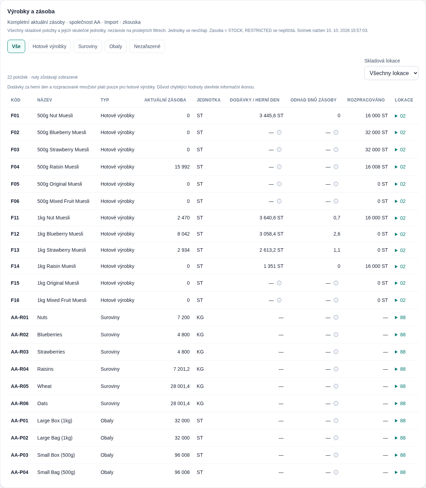

# Kompletní aktuální zásoby

Změna vychází z `feat/web-supabase` po sloučení PR #3 (`e547454`) a mění pouze web. **SQL migrace ani aktualizace Python synchronizátoru nejsou potřeba.** Snímky již obsahují potřebná pole a pravidla; původní opravy Windows a samostatná tržní tabulka zůstávají zachované.

## Zdroj a klasifikace

Tabulka bere kompletní `Current_Inventory.rows`: `PLANT`, `MATERIAL_NUMBER`, `MATERIAL_DESCRIPTION`, `STORAGE_LOCATION`, `STOCK`, `RESTRICTED`, `UNIT`. Nepoužívá prodeje ani výrobní příkazy jako seznam skladových položek, nesčítá jej s `Inventory`, KPI či alternativním importem. Odděluje vybranou hru (načítaný DashboardData), původ a společnost/PLANT. Jednotka ST, měna, oblast, výrobek a kanál prodejní analýzy neomezují skladový seznam.

Typ se určuje z produktových pravidel `Current_Game_Rules` pro přesný materiál a stejnou společnost. Ověřené hodnoty z Introduction jsou `Finished products`, `Packing`, `Perishable`; jejich přiřazení hotovým výrobkům, obalům a surovinám potvrzuje také přiložený InventoryExport (`Finished Goods`, `Packaging`, `Raw Materials`). Pokud je ve stejném původu dostupný tento export, lze použít jeho doloženou kategorii pro přesný materiál. Jeho množství se nepřičítá. Neznámý nebo konfliktní typ se zobrazí jako **Nezařazené**, nikdy se neodvozuje z prefixu F/R/P nebo z jednotky.

Zobrazovací kódy zůstávají v konvenci PR #3: `AA-F01` → `F01`, ostatní skutečné kódy se nepřepisují. Zdrojový materiál je zachovaný v modelu a tooltipu. Různé materiály nebo jednotky zůstávají samostatnými položkami. Nulová zásoba se neskrývá.

## Lokace a množství

Hlavní řádek ukazuje součet **STOCK** přes jednoznačné skladové lokace daného materiálu, společnosti a jednotky. **RESTRICTED se nepřičítá ani automaticky neodečítá**; je zobrazen jako samostatný zdrojový údaj v detailu. Z metadat se neodvozuje nový ukazatel „volná zásoba“.

Shodné opakované záznamy stejné lokace se započtou jednou (bez závislosti na syntetickém ROW_ID). Rozporné hodnoty stejné lokace se nesčítají; celková zásoba je Nedostupné, detail ukazuje konfliktní pozorování. Chybějící množství znamená Nedostupné, nikoli nulu. Více pozorování s neznámou lokací se také nesčítá, protože nelze prokázat jejich odlišnost. Přesné Decimal součty se formátují až v UI.

Filtr lokace vybírá položky, které v lokaci existují. Hlavní množství zůstává za celou společnost, což je nad tabulkou výslovně uvedeno. Rozpis lokací ukazuje dílčí množství; není další položkou přičítanou k hlavnímu řádku. Nevytváří se celkový součet smíšených KG/ST/ostatních jednotek.

## Odhady

Hotové výrobky zachovávají dodávky za nejvýše 5 pozorovaných herních kroků, odhad dnů zásoby a nedokončené množství výrobních příkazů. Použijí se pouze údaje stejné společnosti, původu, materiálu a jednotky. Nejde o převod času stažení na herní čas ani o předpověď poptávky. Chybějící dodávky/čas, nulové tempo, rozporná zásoba nebo nesrovnatelné jednotky nevedou k odhadu. Prázdný dostupný snímek příkazů může znamenat WIP 0; chybějící zdroj znamená Nedostupné.

Suroviny, obaly a nezařazené položky nepoužívají tempo prodejů k odhadu spotřeby. Dostupné `BOM_Changes` dokládají změny, nikoli úplnou aktuální recepturu; samy s výrobními příkazy neprokazují úplnou spotřebu. Výdrž zůstává **Nedostupné** s vysvětlením, dokud nebude dostupná ověřená spotřeba nebo úplná receptura s výrobním plánem. Také upozornění na dny zásoby používají pouze doložené hotové výrobky.

## Kompaktní zobrazení

Tato prezentační úprava vychází ze sloučeného PR #4 (`a77be60`). Analytické funkce ani zdrojová data se nemění.

Chybějící vypočitatelná hodnota se zobrazuje jako — s informační ikonou. Důvod je dostupný při najetí myší, zaměření klávesnicí i kliknutí/dotyku; Escape nebo kliknutí mimo jej zavře. Vysvětlivka se vykresluje mimo posuvný kontejner, aby nebyla oříznutá. U surovin, obalů a nezařazených položek je tempo a rozpracovanost pouze —; záhlaví jednou vysvětluje platnost těchto ukazatelů pro hotové výrobky. Důvod chybějící výdrže zůstává pod ikonou. Odhad dnů se formátuje nejvýše na jedno desetinné místo, skutečné nuly jako 0. Rozpory lokací zůstávají viditelně označené. Výpočty a vstupní data se nemění.

## Ověření a screenshot

- Skutečný Introduction sešit: 22 položek = 12 hotových výrobků, 6 surovin KG, 4 obaly ST; 8 nulových zásob hotových výrobků. Suroviny a obaly v původním sešitu nulovou zásobu nemají; jejich nuly se ověřují pouze v cílených testech a prohlížečových testovacích odpovědích, ne změnou živých dat.
- Testy ověřují typ/lokaci, společnost a původ, oddělení jednotek, neznámou klasifikaci, deduplikaci/konflikty, nepřičítání RESTRICTED a zachované odhady hotových výrobků. Spuštění: `npm --prefix web test`, `npm --prefix web run typecheck`, `npm --prefix web run build`.
- `node web/scripts/inventory-smoke.mjs` používá pouze existující localhost demo. Kontroluje všech 22 skutečných řádků, typy/lokace, detail, prodejní přepnutí ST→KG bez ztráty položek ST a mobilní posuv. Další odpovědi v prohlížeči testují suroviny/obaly s nulou a nezařazenou položku v L bez prodejů/příkazů; do databáze se neukládají.
- Screenshot se pořizuje před testovacími úpravami z původního sešitu. Manufacturing Extended a konkrétní produkční nasazení vyžadují samostatné ověření skutečných pravidel a dat.

