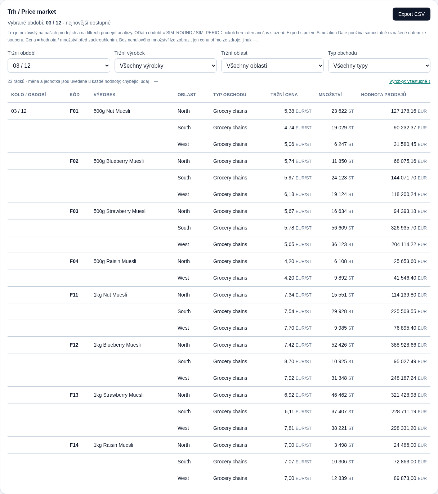

# Trh / Price market a kódy výrobků

Změna je pouze ve webu, nad `feat/web-supabase` po sloučení PR #2 (`3a12a16`). Není potřeba SQL migrace, změna uložených snímků ani aktualizace Python synchronizátoru. Oddělené Windows prostředí a spouštěče z PR #2 zůstávají zachované.

## Datový význam

- OData `Market`: `SIM_ROUND` (Simulation Round) a `SIM_PERIOD` (Simulation Period). Metadata neobsahují `SIM_STEP`, `SIM_DATE` ani `MATERIAL_NUMBER`. Zobrazujeme kolo / období přesně ze zdroje; nepřevádíme je na herní dny nebo reálný čas.
- XLSX `MarketExport`: `Simulation Date`, `Material`, `Description`, `Area`, `Price`, `Quantity`, `Value`. Datum je označeno **Simulation Date**, nepoužívá se jako `SIM_PERIOD`. Tento export neobsahuje měnu, jednotku ani kanál: bez ověřeného údaje ukazuje —.
- Katalog výrobků čte skutečné `MATERIAL_NUMBER` / `Material` + popis a produktové řádky `Current_Game_Rules` (`ELEMENT` + `DETAIL`). Používá pouze vybranou hru, původ a společnost. Zůstává existující zkrácený zobrazovací formát materiálu `AA-F01` → `F01`; jiné kódy se nepřepisují a nikdy nevznikají podle pořadí. Zdrojové řádky zůstávají beze změny.
- Trh bez materiálového čísla používá přesnou shodu popisu s katalogem pouze při jediném odpovídajícím kódu. Chybějící nebo nejednoznačná vazba je viditelně označena; neskrývá tržní řádek.
- Názvy typů obchodů pocházejí z pravidel nebo `DC_NAME` v aktuálních cenách. Při neznámém či nejednoznačném názvu zůstává kód. Žádný seznam Introduction kanálů není vložen napevno.

Tabulka nepoužívá vlastní prodej jako podmínku existence řádku. Čte samostatně kompletní dostupný `Market`, případně `MarketExport`; alternativní zdroje nesčítá. Filtry trhu jsou samostatné. Výchozí období je nejnovější podle zdrojového kola/období, nikoli podle pořadí řádků či času stažení.

Agregace zachovává výrobek/popisek, kolo/období, oblast, kanál, měnu a jednotku. Neúplné nebo nejednoznačné klíče se neslučují. Cena používá přesné Decimal součty hodnoty / množství, bez prostého průměru a mezizaokrouhlení. Při nule množství se nedělí, nula v množství/hodnotě zůstává nulou. U jediného zdrojového řádku s chybějícím či nulovým množstvím nebo chybějící hodnotou lze zobrazit přímo dostupnou zdrojovou cenu (včetně skutečné nuly); nejde o agregovaný průměr. Tooltip a CSV rozlišují zdrojovou a váženou cenu. Neúplný součet není vydáván za úplný.

Řazení zachovává hierarchii období → výrobek → oblast → kanál. Uživatel může obrátit pořadí výrobků. Seskupovací příznaky se počítají znovu až po filtrování a řazení. Vizuálně potlačené buňky mají úplný text pro čtečky obrazovky; CSV obsahuje kompletní údaje každého řádku a původní číselnou přesnost.

## Ověření

Analytické testy: `npm --prefix web test`. Skutečný Introduction fixture vzniká původní čtečkou ze sešitu `samples/BIZ SIM data ze zkušebky.xlsx` prostřednictvím `scripts/export_parity.py`. Cílené testy zahrnují více kanálů, neznámý kanál, chybějící vlastní prodej, váženou cenu, oddělení dimenzí, nejednoznačné kódy, nuly/chybějící hodnoty a seskupení/CSV po filtrování. Vícekanálové ukázky existují pouze v testech.

Prohlížečový test `node web/scripts/market-smoke.mjs` vyžaduje existující testovací localhost Auth/PostgREST stack, lokální demo a sestavený web na portu 3000. Kontroluje kód/název ve filtru, krátké kódy osy a celý tooltip, nejnovější tržní období, úplný CSV export, první buňky skupin po filtrování/řazení a vodorovný posuv při šířce 390 px. Neprovádí zápisy do databáze. Screenshot níže používá skutečný Introduction sešit, nikoli vložené vícekanálové ukázky.

Manufacturing Extended je připraven dynamickými produkty a kanály; skutečná soutěžní data ještě musí projít ověřením na vašem připojení. Místní testy nepotvrzují nasazení do Vercelu.
